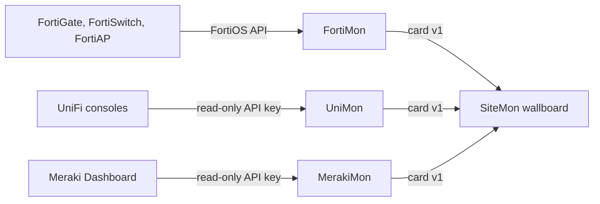

# MonStack

**Network monitoring that tells you what is actually wrong.** MonStack is a family of apps that each watch one vendor's
network gear and show site health, problems with their likely cause, WAN links, devices and history, on a web
dashboard you run on your own server. No agents, no cloud service, and free to use.

Each app has its own repository with its guide, screenshots, releases and issue tracker. This page is the front door:
what the apps are, how they fit together and which version is current.

## The apps

| App | Watches | Status | Repository |
|---|---|---|---|
| **FortiMon** | Fortinet: FortiGate, FortiSwitch, FortiAP | Available | [RowShack/FortiMon](https://github.com/RowShack/FortiMon) |
| **UniMon** | Ubiquiti UniFi | Available | UniMon repository coming soon |
| **MerakiMon** | Cisco Meraki | Available | MerakiMon repository coming soon |
| **SiteMon** | One wallboard across every MonStack app and site | Available | SiteMon repository coming soon |
| SonicMon | SonicWall | Planned | - |

### FortiMon

Reads your FortiGates over the FortiOS REST API. Its diagnostics try to tell you whether something is really wrong and
why: a 0-100 health score per site, problems with evidence and a likely cause, an automatic network map, Wi-Fi,
switches, SD-WAN, VPN and HA, licences and firmware, capacity forecasts, configuration changes and alerts.

### UniMon

Reads your UniFi consoles through their read-only API keys (and optionally the UniFi Site Manager): site health,
devices, Wi-Fi, WAN and the issues that need attention.

### MerakiMon

Reads your Meraki organisations through a read-only Dashboard API key. Each Meraki network is one site, with its
security appliances, switches, access points, internet links, firmware and licences.

### SiteMon

A wallboard for a TV. It never talks to network gear: it shows a tile per site, from every app, with its status, score
and top problem.

### SonicMon

Planned. Nothing is built or promised yet.

All the apps share one look, one sign-in model (users, roles, two-step sign-in), alerts and the same signed updates.
Some features are not yet checked on real gear; each app's page says which.

## How it fits together

Each app watches its own vendor. Every app also offers the same small summary of its sites, the *card* (contract v1, a
read-only JSON document with a status, score, headline, WAN links and top problems per site). SiteMon either pulls the
cards from the apps it can reach or receives them from apps that push them, and draws one wallboard.

Pull and push use the same card. Pull needs SiteMon to reach the app and an API key from that app; push is for apps
SiteMon cannot reach, and uses a key issued by SiteMon. You can use MonStack apps on their own: SiteMon is optional.

## Latest versions

<!-- versions:start -->
| App | Version | Download |
|---|---|---|
| FortiMon | 1.13.0 | [Download](https://github.com/RowShack/FortiMon/releases/tag/v1.13.0) |
| UniMon | 0.1.2 | [Download](https://github.com/RowShack/MonStack/releases/tag/unimon-v0.1.2) |
| MerakiMon | 0.2.0 | [Download](https://github.com/RowShack/MonStack/releases/tag/merakimon-v0.2.0) |
| SiteMon | 0.1.1 | [Download](https://github.com/RowShack/MonStack/releases/tag/sitemon-v0.1.1) |
<!-- versions:end -->

Each app moves to its own repository for releases as it is set up. Until then its release is listed on this
repository's [releases page](https://github.com/RowShack/MonStack/releases).

## Roadmap

- **Now:** FortiMon has its own repository. UniMon, MerakiMon and SiteMon follow, one at a time.
- **Next:** SonicMon for SonicWall.
- **Not yet checked on real gear:** parts of MerakiMon (VPN & HA, Network Map, Find Device), UniMon with several sites
  on one console, and SiteMon with all apps side by side.

## Updates

Apps update themselves from *Settings > Updates*: they look for a new release once a day, show what is new and, for a
service install, update with **Update now**. They back up your data first and go back to the old version by
themselves if the new one doesn't answer. The updater only accepts packages signed with MonStack's own key, which is
built into each app. No account or token is needed. Checksums are listed with every release (`SHA256SUMS.txt`).

## Help and feedback

Issues are off on this page. Questions, bugs and ideas go to the app's own repository: for now
[FortiMon](https://github.com/RowShack/FortiMon/issues/new/choose); the others will have theirs when they move. Please
give the version and your operating system, and never paste tokens, passwords, configuration files or customer data.

**Security problems:** please don't use public issues. See [SECURITY.md](SECURITY.md) to report them privately.

## Licence

MonStack is free to use and closed source. Read the [licence](LICENSE): you may install and use it, but not copy, sell,
modify or reverse engineer it.

Fortinet, FortiGate, FortiSwitch, FortiAP and FortiOS are trademarks of their owners. MonStack is an independent
product and isn't affiliated with or endorsed by them or by the other vendors named here.
