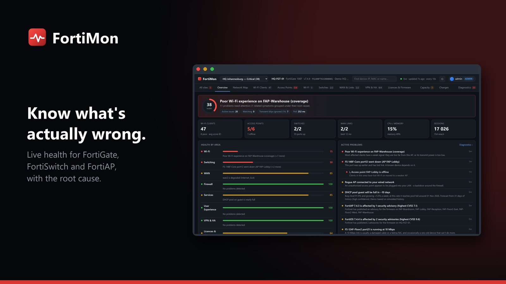
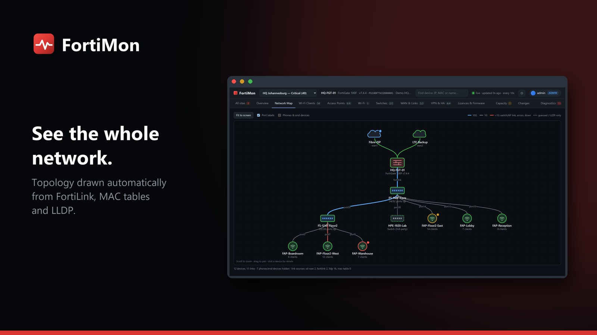

# MonStack

**Network monitoring that tells you what is actually wrong.** MonStack is a family of apps that each watch one vendor's
network gear and show site health, problems with their likely cause, WAN links, devices and history, on a web
dashboard you run on your own server. No agents, no cloud service, and free to use.



## The apps

| App | Watches | Status |
|---|---|---|
| **FortiMon** | Fortinet: FortiGate, FortiSwitch, FortiAP | **Available now** |
| UniMon | Ubiquiti UniFi | Coming soon |
| MerakiMon | Cisco Meraki | Coming soon |
| SonicMon | SonicWall | Coming soon |
| SiteMon | One wallboard across every MonStack app and site | Coming soon |

All the apps share one look, one sign-in model (users, roles, two-step sign-in), alerts and the same signed updates.

## FortiMon

FortiMon reads your FortiGates over the FortiOS REST API and serves a live dashboard. Its diagnostics try to tell you
whether something is **really** wrong, and why, instead of alerting on every blip.



- **Health at a glance.** A 0-100 health score and a plain-language verdict for every site, with the worst problem first.
- **Problems with a cause.** Each issue shows its evidence, the likely cause, related Fortinet known issues and a
  recommended fix. If both internet links drop at once, it reports one shared cause, not two ISP faults.
- **An automatic network map** of internet links, firewalls, switches, access points and other devices.
- **Wi-Fi, switches and WAN.** Every client's experience score, FortiSwitch faceplates with port speed, PoE and errors,
  SD-WAN SLA, throughput and DHCP pool use.
- **VPN and HA.** IPsec tunnels, dial-up users and the HA pair, including failovers.
- **Licences, firmware and advisories.** Expiry dates, firmware status and the Fortinet security advisories that apply to you.
- **Capacity forecasts.** When DHCP pools, WAN links, PoE or the firewall will run out.
- **Configuration changes** for the last 30 days: who changed what, when, with old and new values.
- **Alerts** to Microsoft Teams, webhooks and email, grouped so they don't flood a channel, plus scheduled reports.
- **A NOC wallboard** for a TV, many sites, users with roles, two-step sign-in, backup and restore.
- **Demo mode** with three simulated sites, so you can look around without a FortiGate.

See [more screenshots and the full user guide](docs/fortimon.md).

## Requirements

- A **Windows** server (64-bit), or a **Linux** server with systemd and Python 3.9 or newer (Ubuntu, Debian, RHEL, Rocky
  and similar). Windows includes everything it needs.
- A REST API token for each FortiGate (the guide shows how to make one and test it).
- A web browser. FortiMon serves its dashboard over HTTPS, on port 8443 by default.

## Install

Download the newest files from the [latest release](../../releases/latest).

### Windows

1. Download `FortiMon-<version>.msi` and `SHA256SUMS.txt`.
2. Check the download (see below).
3. Double-click the MSI and answer the questions: run as a Windows service (recommended), who may open the web
   interface, and the port. At the end it opens FortiMon in your browser, where you create the first admin account.

For a silent install: `msiexec /i FortiMon-<version>.msi /qn MODE=service ACCESS=all PORT=8443`.

**Windows may warn you.** The installer isn't signed with a paid code-signing certificate yet, so SmartScreen can show
"Windows protected your PC". Check the SHA-256 below first. If it matches, choose **More info**, then **Run anyway**.

### Linux

```
sudo sh fortimon-<version>-linux.run
```

It asks whether to install a systemd service (recommended), the port, whether other computers may connect and whether to
open the firewall. For no questions, add `--unattended --service --port 8443`.

### Check the download

Each release lists `SHA256SUMS.txt`. The checksum of your file must match its line there.

```
# Windows (PowerShell)
Get-FileHash .\FortiMon-<version>.msi -Algorithm SHA256

# Linux
sha256sum -c SHA256SUMS.txt --ignore-missing
```

The in-app updater goes further: it only accepts releases signed with MonStack's own key, which is built into the app.

## Updates

FortiMon looks at this page once a day (*Settings > Updates*), shows what's new and, for a service install, can update
itself with **Update now**: it backs up your data, installs the new version, checks it answers and goes back to the old
version by itself if it doesn't. Servers without internet access can use the *offline update* file from the release.
No account or token is needed.

Versions **before 1.11.1** looked at an older page, so install 1.11.1 once by running its installer over the top. Your
data and settings are kept.

## Help and feedback

- **Questions, bugs and ideas:** [open an issue](../../issues/new/choose). Please give the version and your operating
  system, and never paste tokens, passwords, configuration files or customer data.
- **Security problems:** please don't use public issues. See [SECURITY.md](SECURITY.md) to report them privately.

## Licence

MonStack is free to use and closed source. Read the [licence](LICENSE): you may install and use it, but not copy, sell,
modify or reverse engineer it.

Fortinet, FortiGate, FortiSwitch, FortiAP and FortiOS are trademarks of their owners. MonStack is an independent
product and isn't affiliated with or endorsed by them or by the other vendors named here.
