# FortiMon: live FortiGate network monitor

The screenshots below are from FortiMon's demo mode: three simulated sites with built-in faults, so no customer data appears in them.

### All sites

Every site's health score, top problem and trends: you see which site needs attention first.

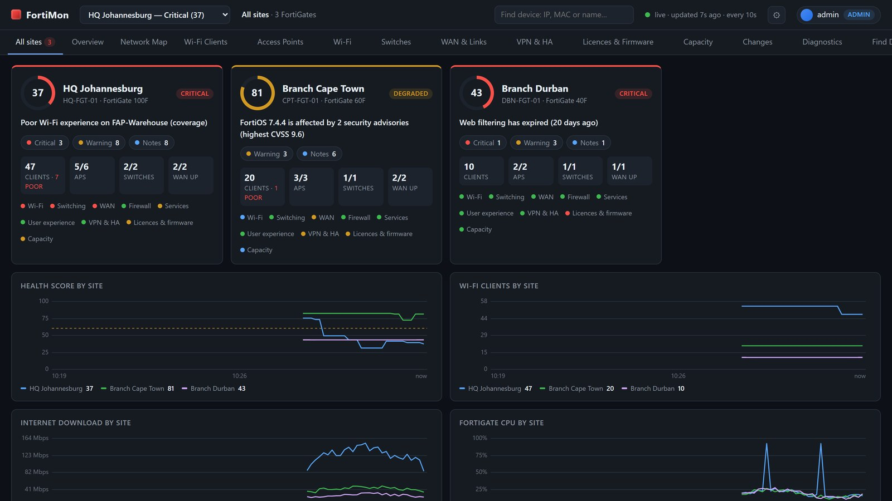

### One site

A health score and a plain-language verdict, then which area is hurting and why.

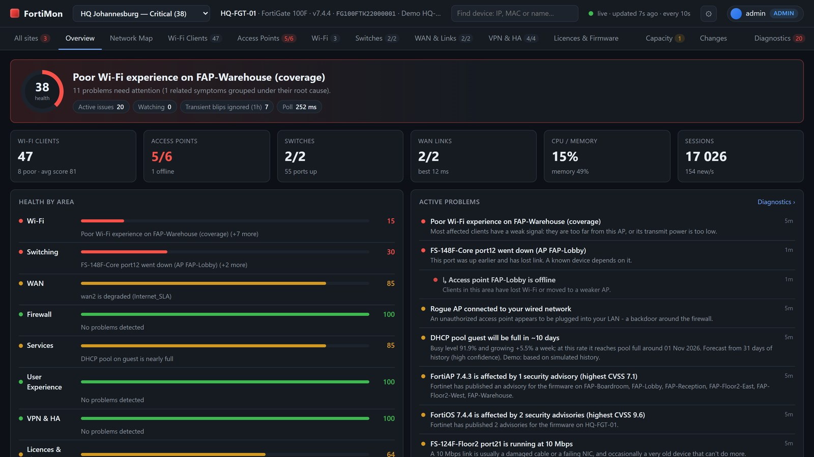

### Light theme

The same page in the light theme.

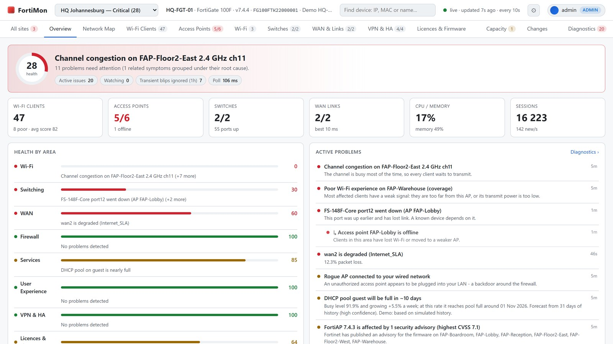

### Network map

The topology drawn automatically: internet links, firewall, switches, access points and other kit.

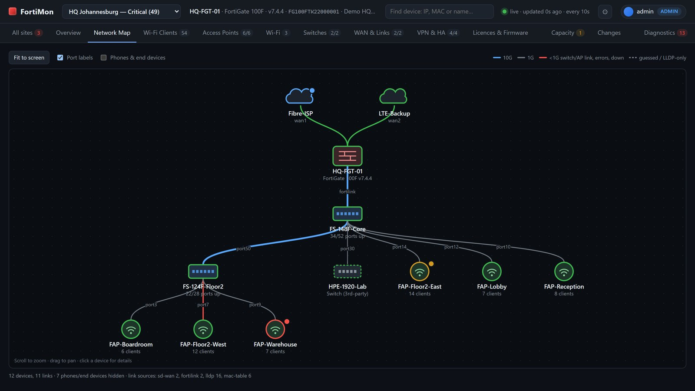

### Root cause

An issue opened: the evidence, the likely cause, related Fortinet known issues and the recommended fix.

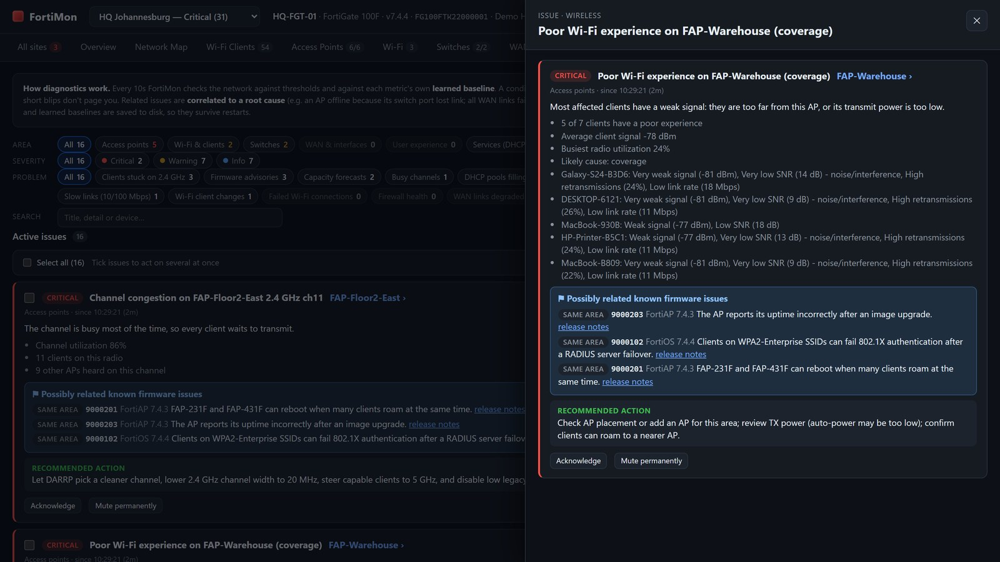

### Switch ports

FortiSwitch faceplates with port speed, PoE, errors and what is plugged in where.

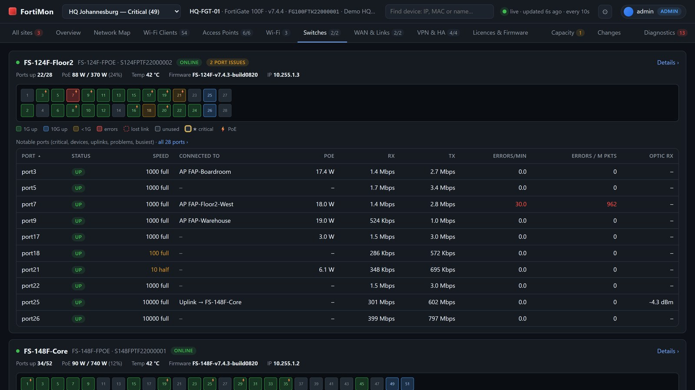

### Wi-Fi clients

Every client with signal, SNR, retries and an experience score.

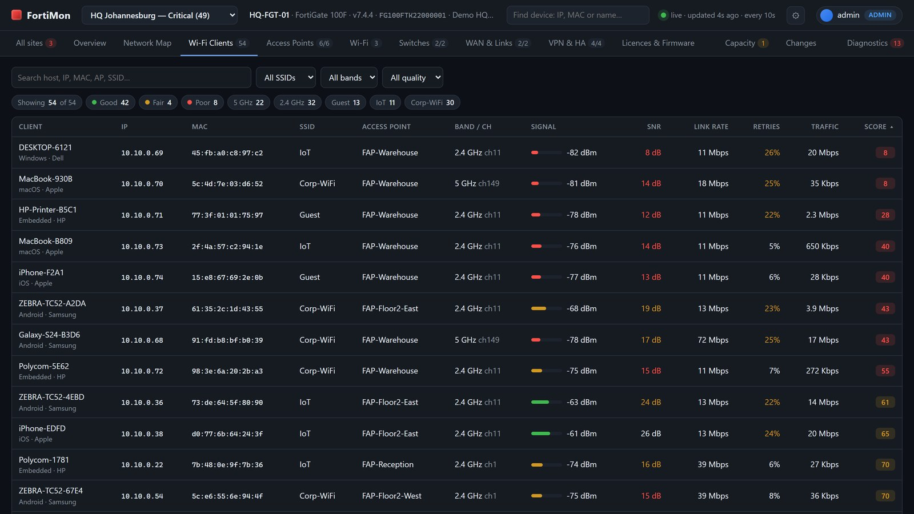

### VPN and HA

IPsec tunnels, dial-up users and the HA cluster.

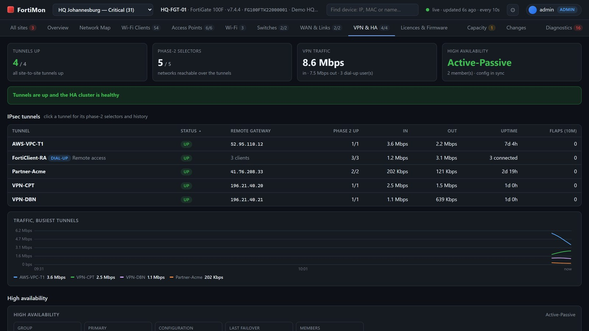

### Licences and firmware

Licence expiry, firmware status and the Fortinet advisories that affect you.

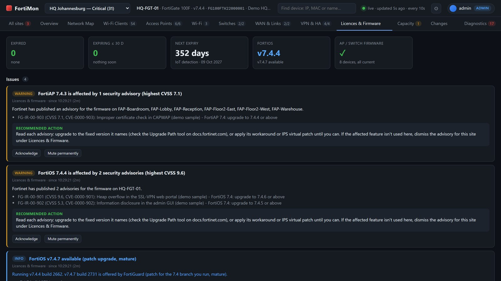

### Capacity forecasts

When DHCP pools, WAN links, PoE and the firewall will run out.

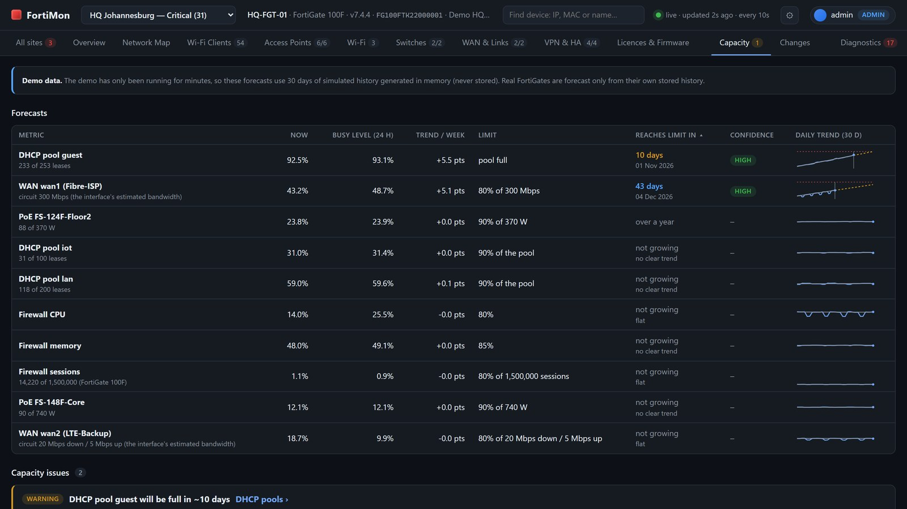

### Configuration changes

Thirty days of who changed what, when and how, with old and new values.

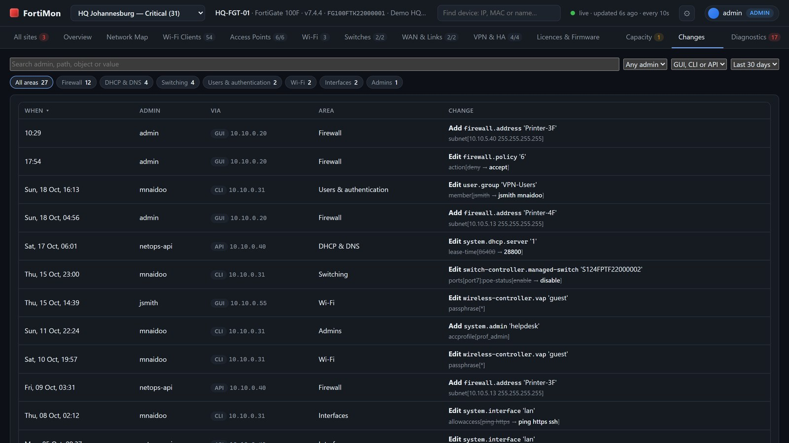

### Alerts

Teams channels and email, each with its own filters.

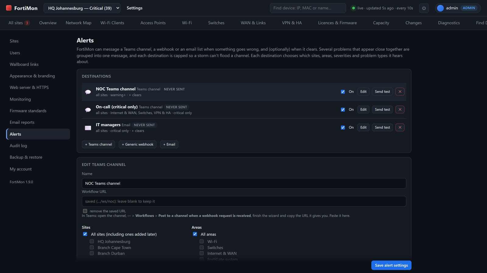

### NOC wallboard

A full-screen wallboard for a TV: every site and the worst problems.

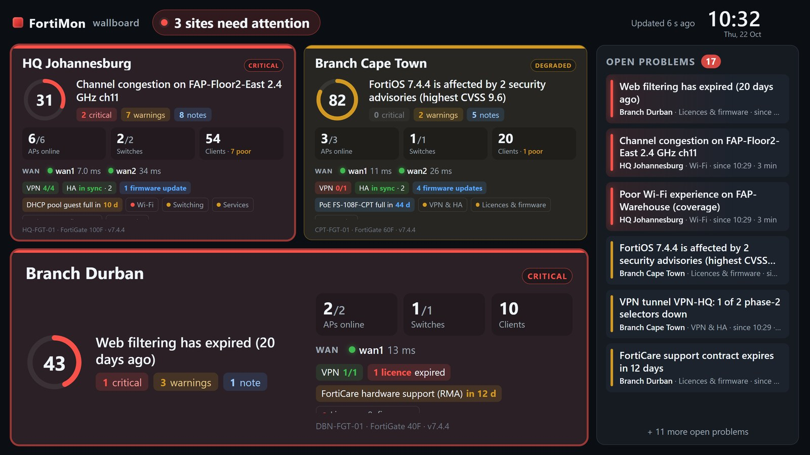

---

FortiMon runs on a Windows or Linux server, connects to one or more FortiGates' REST APIs and
serves a live web dashboard covering Wi-Fi clients, FortiAPs, FortiSwitches, WAN/SD-WAN links,
interfaces and DHCP. Its diagnostics engine tries to tell you whether something is **actually**
wrong instead of alerting on every blip. History is saved to disk, so it survives restarts.

People sign in to the web interface. **Admins** manage sites, API keys, users and settings there;
**operators** can also acknowledge and mute issues; **view-only** users see everything but can't change
anything. Operators and view-only users can be limited to some sites. A full-screen **wallboard** shows
every site's health on a NOC TV.

## Install

### Windows: `FortiMon-<version>.msi`

Double-click the MSI. Besides the install folder, it asks:

| Question | Choices |
|---|---|
| **Run FortiMon** | **As a Windows service** (recommended): starts with Windows, keeps monitoring when nobody is signed in, restarts itself if it stops. Or **as a program** that runs only while it's open. |
| **Who can open the web interface** | **Other computers on the network** (adds a Windows Firewall rule for FortiMon) or **only this computer**. |
| **Port** | 8443 by default (HTTPS). |

Python is built in; nothing else needs installing. At the end it opens FortiMon in your browser.

The service is called **FortiMon** in services.msc and runs as its own low-privilege account,
`NT SERVICE\FortiMon`. Its data (settings, users, history, certificates, logs) is in
`C:\ProgramData\FortiMon`, which only Administrators, SYSTEM and the service can open.
Uninstalling FortiMon keeps that folder; delete it yourself to remove everything.

**Tray icon.** With the service, everyone who signs in to the server gets a FortiMon icon in the
taskbar notification area. Its dot shows the service's state:
- **green:** running
- **amber:** starting or stopping
- **red:** stopped
- **grey:** not installed or unknown

Hover over it for the state in words. Double-click opens the dashboard.

Right-click for:
- **Open FortiMon**
- **Start**, **Stop** or **Restart** the service
- **Open log**
- **Exit** (hides the icon until the next sign-in, or Start menu > *FortiMon tray icon*)

Starting, stopping and restarting the service and opening the log need an administrator, so Windows
asks for permission (UAC) each time. A notice pops up when the action is done or if the service
stops.

Silent install, e.g. with Intune, GPO or an RMM tool:

```
msiexec /i FortiMon-1.1.0.msi /qn MODE=service ACCESS=all PORT=8443
```

`MODE` is `service` or `app`, `ACCESS` is `all` or `local`. Upgrades keep the previous choices and
all data: just install the newer MSI.

### Linux: `fortimon-<version>-linux.run`

Works on Ubuntu, Debian, RHEL, Rocky and similar, with Python 3.9 or newer (installed on almost every
distribution).

```
sudo sh fortimon-1.1.0-linux.run
```

It asks the same questions as the Windows installer: install as a **systemd service** (recommended),
the **port**, whether **other computers** may connect and, if a firewall (ufw or firewalld) is
active, whether to open the port. Run it again with a newer version to upgrade; data is kept.

| | |
|---|---|
| Program | `/opt/fortimon` |
| Data | `/var/lib/fortimon` (owned by the `fortimon` service user) |
| Service | `systemctl status fortimon`, logs with `journalctl -u fortimon -f` |
| Command | `sudo fortimon --help` runs FortiMon's commands against the service's data |
| Uninstall | `sudo /opt/fortimon/uninstall.sh` (add `--purge` to delete the data too) |

Unattended: `sudo sh fortimon-1.1.0-linux.run --unattended --service --port 8443`
(`--local-only`, `--no-firewall`, `--no-service` also work; `--help` lists everything).

### Demo mode

`--demo` (or `start-demo.bat`) runs three simulated sites that have faults built in, so you can
explore the dashboard without a firewall:

- **HQ:** an AP outage traced to its switch port, a cable throwing CRC errors, a Wi-Fi coverage
  hole, a full DHCP pool, a rogue AP and WAN packet loss.
- **Cape Town:** both internet links fail at the same moment, which is reported as one shared
  cause rather than two ISP faults.
- **Durban:** healthy.

Demo mode keeps its own settings and users (`config-demo.json`, `admin-demo.db`).

## First sign-in

Open `https://<server>:8443/`. The first time, FortiMon asks you to **create the first admin
account**. After that everyone signs in with their own account.

- **Certificate warning:** FortiMon makes its own (self-signed) HTTPS certificate, so browsers warn
  the first time. Continue past the warning, or put your company's certificate in under
  **Settings > Web server & HTTPS**.
- **Setup code:** if you create the first account from another computer rather than on the server
  itself, FortiMon asks for a setup code. It's in `setup-code.txt` in the data folder and in the log.
  This stops someone else on the network from claiming a fresh install first.

## Users and roles

| Role | Can |
|---|---|
| **Admin** | Everything: add and remove sites and their API keys, manage users, change the web server (port, HTTPS certificate), monitoring and email-report settings, acknowledge and mute issues, save reports, read the audit log, back up and restore. |
| **Operator** | Everything a view-only user can, plus acknowledge and mute issues (one at a time or in bulk) and save reports. Can't change settings, sites or users. |
| **View only** | Every dashboard, the network map, device search, diagnostics and reports. Can't change anything, including acknowledging issues. |

**Site access.** Operators and view-only users can be limited to some sites (tick them when adding
the user, or **Change** in the *Sites* column). They then only see those sites everywhere: the
site list, dashboards, device search, live reports, the wallboard and the API. Saved all-site reports
are hidden from them, and they can't save one. No sites ticked means every site, including sites added
later. Admins always see every site.

Admins add users under **Settings > Users** with a temporary password. By default the user must
choose their own password when they first sign in. From the same page admins can:
- change a user's role and the sites they see,
- reset a password (this signs them out everywhere),
- disable or delete an account.

FortiMon always keeps at least one active admin. Everyone can change their own password under
**My account** (the menu at the top right).

Sign-in protection:
- **Two-step sign-in:** optional authenticator-app codes, see [Two-step sign-in](#two-step-sign-in).
- **Lockout:** after 5 wrong passwords in 15 minutes from one address or for one username, sign-in
  is locked for a while.
- **Session expiry:** sessions end after 24 hours without use, and 14 days after signing in at the
  latest.

**Forgotten password, and no other admin?** On the server itself, run:

```
"C:\Program Files\FortiMon\FortiMon.exe" --reset-password admin     (Windows, as Administrator)
sudo fortimon --reset-password admin                                 (Linux)
python fortimon.py --reset-password admin                            (from source)
```

It asks for a new password. If the user doesn't exist, it creates it as an admin.

## Two-step sign-in

Anyone can add a second step to their own sign-in, and admins can require it.

**Setting it up** (under **My account**, the menu at the top right):
1. Choose **Set up** under *Two-step sign-in*.
2. In an authenticator app (Microsoft Authenticator, Google Authenticator, Authy or similar), scan the QR code. If you
   can't scan, type the key shown instead.
3. Enter the 6-digit code the app shows.
4. Save the **10 backup codes**. They're shown once; download or copy them and keep them somewhere safe.

After that, signing in asks for the password and then a code. A backup code works instead of the app's code, once each.
Under **My account** you can make new backup codes or turn two-step sign-in off (both need your password).

**Requiring it.** Under **Settings > Users**, *Require two-step sign-in for* can be **Nobody** (the default),
**Admins** or **Everyone**. People it applies to must set it up at their next sign-in, and can't turn it off.

**Lost phone?** Sign in with a backup code and set up again. With no backup codes, ask an admin to press **Reset MFA**
next to the user under **Settings > Users**; the user is signed out and sets it up again at the next sign-in. If no
other admin can do it, run this on the server itself:

```
"C:\Program Files\FortiMon\FortiMon.exe" --reset-mfa admin     (Windows, as Administrator)
sudo fortimon --reset-mfa admin                                 (Linux)
python fortimon.py --reset-mfa admin                            (from source)
```

Notes: wallboard display links don't use two-step sign-in. It isn't included in a backup file, so after restoring on
another server users set it up again.

## Settings (admins)

The gear button at the top right (or the user menu) opens **Settings**:

| Section | What admins manage |
|---|---|
| **Sites** | Add, edit, pause or delete FortiGates: name, address, admin HTTPS port, API token, VDOM, event-log location, certificate checking. **Test connection** runs the full API test (below) before you save; a site's editor shows its last test result, with when and who. A data set that is slow to answer (switch health with many FortiSwitches) is a warning, not a failure: FortiMon gives it more time automatically. Tokens are stored encrypted and never shown again. Changing a site's address requires entering its token again. |
| **Users** | See [Users and roles](#users-and-roles). Also where admins require [two-step sign-in](#two-step-sign-in) and reset it for a user. |
| **Wallboard links** | Display links for screens nobody signs in to. See [Wallboard](#wallboard-noc-tv). |
| **Appearance & branding** | Dark / light / follow the device, the accent colour, your product name and logo. See [Appearance and branding](#appearance-and-branding). |
| **Web server & HTTPS** | Who can connect (this computer or the network), the port, HTTPS on/off, the address used in email links, and the HTTPS certificate: upload your own (PEM) or create a new self-signed one. A new port takes effect immediately; the page moves to it. |
| **Monitoring** | The poll interval, how long history is kept, the weekly and monthly saved reports (day and time), and the user-experience probes: which site this server is at, and the probe list. |
| **Firmware standards** | The firmware version each model should run (all sites, or per site), fetching Fortinet's known issues and security advisories (on/off, optional proxy, **Refresh now**). See [Licences & firmware](#licences--firmware). |
| **Email reports** | The SMTP server and who gets which reports for which sites. See below. |
| **Alerts** | Send new issues to Teams, a webhook or email as they happen. See [Alerts](#alerts). |
| **Audit log** | Every sign-in (including failed ones), settings and user change, acknowledgement, mute and report email, with who, when and from which IP. Kept for 400 days. |
| **Backup & restore** | Download all settings and users as one file, and restore it, e.g. on a new server. |

Changes apply immediately: no restart needed.

### Adding a FortiGate

1. On the FortiGate, create a read-only REST API admin:
   - *System > Admin Profiles*: create a profile with **Read** access to System, Network,
     WiFi & Switch Controller and Log & Report.
   - *System > Administrators > Create New > REST API Admin*: assign that profile and add the
     FortiMon server's IP under **Trusted Hosts**. Copy the API key it shows; it's only displayed
     once.
2. In FortiMon: **Settings > Sites > + Add FortiGate**. Enter the name, address, admin HTTPS port
   and the API key. Click **Test connection**, then **Add site**. Data appears within seconds.

### Email reports

**Settings > Email reports**:
- **Mail server:** enter your SMTP server. Microsoft 365, Google Workspace and internal relays all
  work, and there are hints for each. Use **Send test email** to check it.
- **Recipients:** add anyone who should get reports. They don't need a FortiMon account. For each
  recipient, choose:
  - **Weekly** and/or **monthly**;
  - **Sites:** all sites (including ones added later) or particular sites;
  - **On/off:** whether they get emails at all right now.

Each person gets their own email: a summary table (status, average health, critical and warning
counts per site) with the full report attached as an HTML file.
- **When:** the weekly report goes out on the day and hour set under Monitoring (Monday 06:00 by
  default); the monthly report goes out on the 1st, covering the previous month.
- **Delivery status:** the last result for each recipient is shown, and every email sent or failed
  is in the audit log. Restarts never send twice.
- **Send now:** sends this week's report to one recipient, or to everyone, straight away.

### Alerts

**Settings > Alerts** sends issues to people as they happen, instead of waiting for someone to look at the dashboard.
Add one or more **destinations**:
- **Microsoft Teams:** posts a card to a channel through a Workflows webhook (steps below).
- **Webhook:** posts JSON to any HTTPS address, for other chat tools or ticketing systems.
- **Email:** sends to a list of addresses using the SMTP server set under **Email reports**.

Each destination has its own filters, so a channel can get just what it needs:
- **Sites** and **areas** (Wi-Fi, switching, WAN and so on);
- **minimum severity** (warning or critical; a critical port always alerts);
- **problem types** (ports down, APs offline and so on);
- whether to also send when an issue **clears**, and when a **configuration change** is detected.

How alerts behave:
- Issues raised close together are grouped into **one message per minute**, and each destination is capped per hour.
- **Muted** and **score-excluded** issues never alert. An **acknowledged** issue only alerts again if it gets worse.
- A failed delivery is retried a few times. Each destination keeps a **delivery log**, and admins see a warning banner if
  a destination has been failing for over an hour.
- **Send test** sends a clearly marked sample message to check a destination.
- **Open in FortiMon** links in messages need the dashboard address under **Settings > Web server & HTTPS**. They open
  the issue in Diagnostics.

**Creating the Teams URL (Workflows):**
1. In Teams, open the channel, choose **⋯ > Workflows**.
2. Pick **Post to a channel when a webhook request is received**, name it, and choose the team and channel.
3. Copy the URL it shows, and paste it into the destination in FortiMon. Then press **Send test**.

Microsoft is retiring the old Office 365 **Incoming Webhook** connectors, so use a Workflows URL; old connector URLs
will stop working. Phones get the alerts through the Teams mobile app: turn on notifications for the channel.

### HTTPS

HTTPS is on by default. On first start FortiMon creates a self-signed certificate (RSA 2048,
SHA-256) for the server's names and IP addresses, and renews it automatically before it expires.
To stop the browser warning:
- upload a certificate from your company CA (PEM certificate plus key, optionally with an
  encrypted key) under **Settings > Web server & HTTPS**, or
- trust FortiMon's own certificate on the computers that use it.

If someone types `http://` on the HTTPS port, they're redirected to `https://`. Turn HTTPS off only
behind a reverse proxy that does HTTPS (`--http` on the command line does the same).

### Backup & restore

The backup is one JSON file containing:
- sites, monitoring, email and web settings;
- users (as password hashes; FortiMon never stores passwords).

If you include the FortiGate API keys and the SMTP password, they're encrypted with a **backup
password** you choose, so the file can be restored on a different server.

Restoring replaces the sites and settings and, if you choose, all users. Everyone is then signed out.
The port and certificate of the server you restore onto are kept. The history database isn't in the
backup; copy `fortimon.db` from the data folder if you need it.

## Testing API access (`apitest.py`)

The same checks run from **Settings > Sites > Test connection**. On the command line it's useful
before installing, or when a site shows as unreachable or is missing data:

```
FortiMon.exe test-api --host 192.168.1.99      (Windows; asks for the token, not saved)
sudo fortimon test-api --host 192.168.1.99     (Linux)
python apitest.py --host 192.168.1.99          (from source)
python apitest.py                              (every FortiGate in the settings)
python apitest.py --site hq                    (only FortiGates whose name contains "hq")
```

Without `--host`, it tests the FortiGates in FortiMon's settings. On an installed copy it finds them in the
service's data folder (`C:\ProgramData\FortiMon`) or, when FortiMon runs as a program, in your own
(`%LOCALAPPDATA%\FortiMon`); run it as the Windows user that runs FortiMon, since that user's key decrypts
the stored API tokens. Use `--data-dir <folder>` if the settings are somewhere else. Put quotes around a
site name with spaces: `--site "HQ Johannesburg"`.

For each FortiGate it checks four things in order:

1. **Network:** DNS, the TCP port, and the TLS certificate (trusted or not, and expiry).
   - *Port refused:* usually the wrong admin port. When SSL-VPN uses 443, the admin GUI is often
     on 8443 or 10443.
   - *Timeout:* routing, or HTTPS admin access is not enabled on that interface.
   - *TLS failure:* the port is not HTTPS.
2. **Token:** whether the FortiGate accepts it.
   - *401:* the token is wrong, or this PC is not in the API admin's trusted hosts. The tool shows
     the IP the FortiGate sees this PC as.
   - *403:* the admin profile is missing permissions.
   - The tool also spots when the port is actually the SSL-VPN portal.
3. **Endpoints:** every API call FortiMon makes, with HTTP status, response time, size and record
   count. It also checks that the fields FortiMon relies on exist on your FortiOS version. Each
   problem says which dashboard feature it affects and how to fix it, for example: *"Admin profile
   needs Read access to 'WiFi & Switch'. Without it FortiMon loses the Wi-Fi Clients tab"*, or
   *"missing 'retries' -> retransmission detection won't work"*.
4. **What FortiMon will see:** runs your real data through FortiMon's own parser and diagnostics:
   - the device counts it will see,
   - how complete the data is (for example "signal 100%, SNR 0%"),
   - whether APs could be matched to their switch ports,
   - a first look at the conditions it would start watching.

The result is PASS, PASS with warnings (works with reduced features) or FAIL. The exit code is 0,
1 or 2, so you can use it in scripts.

Other options:

| Option | What it does |
|---|---|
| `--path /api/v2/monitor/system/ha-peer` | GET any API path and print the JSON (add `--param key=value` for query parameters) |
| `--dump FOLDER` | Save every raw API response as a JSON file |
| `--redact` | Mask IPs, MACs, serials, and host and user names (consistently), so dumps can be shared safely |
| `--report FILE` | Write the results as JSON |
| `--list` | List the API endpoints FortiMon uses and the permission each needs |
| `--demo` | Try the tool against the simulator |

The token is never printed (only its first 4 characters) and never written to dumps or reports.

## Network map

The **Network Map** tab draws each site as a tree. The internet links are at the top, then the
FortiGate, then its switches, then the APs and other devices below them. Each link is worked out
from the most reliable source available:

1. **FortiLink peers** on FortiSwitch ports: switch-to-FortiGate and switch-to-switch (ISL) links.
2. **The switch MAC table:** which port each FortiAP is plugged into. The last known port is
   remembered, so an offline AP stays in the right place.
3. **LLDP** from the FortiGate, the FortiSwitches and the FortiAPs. This confirms the links above
   and finds devices you don't manage through the FortiGate, such as third-party switches, IP
   phones and routers.
4. **Inference:** a managed device whose uplink is unknown is drawn with a dashed line straight to
   the FortiGate.

Link colours: blue is 10G, grey is 1G, amber is below 1G, red means errors and dashed red means
down. Hover over a device or link for details, and click one to open its drill-down. Scroll to
zoom and drag to pan. Phones and other end devices are hidden by default; there's a checkbox to
show them.

FortiOS has no REST API endpoint for FortiSwitch LLDP neighbours; that table is only available
from the CLI. FortiMon asks for it in case a future release adds it. Until then it shows as "not
supported" and the map is built from FortiLink, the MAC table and FortiGate/FortiAP LLDP, so only
third-party switches and phones are missing from it. `apitest.py` shows which sources your
FortiGate provides.

## Find device

Type an IP, a MAC address (any format, or just part of one), a hostname or a vendor into the box at
the top, or use the **Find Device** tab. It searches every site and shows where each match is
connected:

> HQ-FGT-01 › fortilink FS-148F-Core › port30 › HPE-1920-Lab

Wi-Fi clients show their AP, SSID, band and signal. Wired devices show their switch, port and
VLAN, and also any third-party switch they sit behind. A MAC address is learned on every uplink
between the device and the FortiGate, so FortiMon always uses the edge port. **Show on map**
highlights the full path.

Device locations are saved, so a device that has disconnected is still found, with when and where
it was last seen.

## Changes (configuration changes, last 30 days)

The **Changes** tab lists every configuration change made on the site's FortiGate in the last 30 days
(1, 7 or 90 days on request), newest first:

- **who** made it, **how** (GUI, CLI or API, with the address they came from) and **when**;
- **what** changed: the action, the configuration path and object (for example
  `switch-controller.managed-switch` 'S124FPTF22000002'), and the changed values, with the old value
  struck through and the new one in bold (`vlan[default → Cameras]`);
- the **area** it belongs to (Switching, Wi-Fi, Firewall, Interfaces, Routing & SD-WAN, VPN, HA, ...);
- a ⚑ badge when it is the **likely** cause of a live issue: it changed the same switch, port, AP or SSID
  the issue is about, shortly before the issue started. (A change that only happened in the same area is
  shown on the issue's card as "same area", not flagged here.)

Filter by area, admin or GUI/CLI/API, and search any text. Changes to FortiLink-managed switches and
FortiAPs made through the FortiGate are included; changes made directly on a switch or AP (its own web
page or CLI) are not, because they never reach the FortiGate's log.

FortiMon reads the FortiGate's system event log every 30 seconds, asking for configuration changes
only (older FortiOS versions that don't accept that filter are read unfiltered). On first start it
reads back as far as the log goes, up to 30 days: logs on disk or a FortiAnalyzer hold weeks, the
memory log only hours. Changes are kept in the history database for as long as other events
(90 days by default). Needs read access to **Log & Report** in the API admin profile.

**Logs on a FortiAnalyzer.** For a site set to *FortiAnalyzer / FortiGate Cloud*, FortiMon searches the
FortiAnalyzer through the FortiGate: it starts a search for system events, collects the result on the next
poll and picks out the configuration changes, so a change appears a minute or two after it's made. On an HA
pair each change is logged twice (the second time by `ha_daemon`, when it is copied to the other unit);
FortiMon lists it once.

**The tab stays empty, or a change you made is missing?** Most often the FortiGate keeps its logs
somewhere other than the site's *Event logs are stored in* setting (Memory by default). A FortiGate
without a log disk that sends its logs to a FortiAnalyzer (its Log & Report view offers only
FortiAnalyzer) has an empty memory log. The tab then shows a hint: set *Event logs are stored in* to
**FortiAnalyzer / FortiGate Cloud** under Settings > Sites, or turn on memory logging on the FortiGate
(`config log memory setting` / `set status enable`). To see what each location returns, run
`test-api --site <name> --log-source fortianalyzer` (or `memory`, `disk`): the `admin_log` row warns
when it holds no configuration changes.

## Acknowledging and muting

Admins see two buttons on every issue:
- **Acknowledge:** hides the issue from the health score until it clears. If it gets worse (for
  example a warning turns critical) or comes back later, it's raised again.
- **Mute permanently:** silences that exact check for that device or port until you unmute it.
  Use it for things like a printer that only supports 10 Mbps.

Both take an optional note, are saved to disk, and are listed under *Diagnostics > Acknowledged &
muted*. Events are still logged either way, and the audit log records who did it.

**Several at once:** on the Diagnostics tab, tick the issues (or **Select all**) and use the bar
above the list to **Acknowledge** or **Mute** them together with one note. The same works in reverse
under *Acknowledged & muted*.

**Score exclusions:** under *Diagnostics > Score exclusions* (or on the Wi-Fi tab, or from an AP, switch
or port drill-down) admins and operators can leave SSIDs, access points, switches, ports or networks out of
the health score, for example a guest SSID that isn't business critical. Their issues still show, marked
*not in score*, and are still logged, but don't lower the score or the area status.

**Critical ports:** open a port from the Switches tab and click **Mark as critical port**. If a critical
port loses link (or never had it) that's a critical issue. Critical ports have a ★ on the faceplate, and
the Switches tab lists them with their status.

**Filter by area, severity and type:** the chips at the top of the Diagnostics tab show the active-issue count for each
area:
- Access points
- Wi-Fi & clients
- Switches
- WAN & interfaces
- User experience
- Services (DHCP)
- Firewall

Click one to show only that area; click more to add them; click **All areas** to reset. The filter
applies to the issue lists, *Watching*, *Transient blips* and *Recently resolved*. **Select all**
then picks only what's shown. Next to them, the **severity** chips (critical, warning, info), the
**problem type** chips (for example *Flapping ports* or *Slow links (10/100 Mbps)*) and a search box narrow
the lists further. The filters are remembered in your browser.

**Port and link severities**

| Event | Severity |
|---|---|
| A port going down | Info, and recorded in the link log |
| Something important losing connection because of it (an AP or switch going offline) | Raised as its own issue, with the port as the root cause |
| A port at 10 Mbps | Warning |
| An uplink at 100 Mbps | Info |
| An ordinary port at 100 Mbps | Not flagged |

The port, AP and interface drill-downs show the full link up/down history.

## Smarter diagnostics

**Failed Wi-Fi connections.** FortiMon reads the FortiGate's wireless event log, so it can see
devices that *fail* to connect, not only the ones that are connected. It tells these situations
apart:

| What it sees | What it means |
|---|---|
| Many devices failing on one SSID | Raised as a network problem, for example a changed password, RADIUS or certificate issue |
| One device retrying over and over while others connect | Client-side: a wrong saved password or an expired certificate |
| RADIUS timeouts | The RADIUS server isn't answering |
| Devices not getting an IP | Linked to a full DHCP pool when that pool serves the same SSID |
| Failures concentrated on one AP | That AP is the likely problem |

The Wi-Fi Clients tab shows the failure rate per SSID and the most recent failures.

**Configuration-change correlation.** Admin changes are read from the system event log. When a
problem starts within 30 minutes of a change in the same area, the issue card shows who changed
what, when and from where. A change that names the affected object (for example the SSID) is
marked *likely*. Problems that config can't cause, such as cable errors, optics or one client's
password, are never linked to a change. Every change is also in the event log and the reports.

**Time-of-day baselines.** Each metric learns what's normal for every hour of the week, so a
Monday 09:00 rush and a quiet Sunday night are each compared with their own normal. While it's
still learning, it compares with the same hour on other days, then with the overall average. That
stops false "sudden drop in clients" alerts every evening.

**Loop detection.** If several MAC addresses keep jumping between the same two switch ports, it's
reported as a likely loop (critical). A single device moving between ports, which usually means a
duplicate MAC or a second cable, is a warning. Wi-Fi roaming between APs is ignored.

**Fibre optics (SFP diagnostics).**
- **Light levels:** the receive light on FortiSwitch and FortiGate SFPs is checked against the
  module's own warning and alarm levels.
- **Early warning:** FortiMon also learns each port's normal level and warns when the light drops
  3 dB below it, which is how dirty connectors and damaged patch leads start, before the link
  fails.
- **Where to see it:** the port drill-down shows the module details and the light level over time.

**Errors relative to traffic.** Port and interface errors are also measured per million packets.
30 errors a minute on a busy 10G uplink is noise, but on an idle printer port it's a fault. An
error alert needs both enough errors and enough errors relative to traffic (`port_err_ppm`,
default 50).

## User experience probes (from the FortiMon server)

The FortiGate can only report on itself. Probes test the network from where users are, from the
server FortiMon runs on, every 30 seconds:

| Probe | Tests | Answers |
|---|---|---|
| ping the FortiGate | the LAN path | Is the problem close to the users? |
| DNS query to each resolver | DNS | Is one DNS server down, or all of them? |
| ping / TCP to the internet by IP | raw connectivity | Is the internet reachable at all? |
| HTTPS to real sites | the full user path | Do websites actually load, and how fast? |
| TCP to internal servers (optional) | your own services | Is the file server or app server reachable? |

Combined with what the FortiGate reports, this pins down where a problem is:

| What the probes see | Diagnosis |
|---|---|
| Internet fails from the LAN, but the SD-WAN health checks pass | Firewall policy, NAT or routing on the FortiGate, not the ISP |
| Every DNS server fails but connections by IP work | "DNS is down", which users experience as "no internet" |
| One DNS server fails | That specific server, for example the internal AD DNS |
| An internal probe fails | "Internal server not answering", one issue per server |
| Websites slow while ping is fast | DNS, SSL inspection or web-filter load, or the site itself (FortiGate CPU is shown) |
| An SD-WAN member degraded but probes healthy | "Users are not affected", because traffic is on the working link |

The results appear in **WAN & Links > User experience probes**, with charts and a plain-language
verdict, and in the weekly report. Probes run only for the site the server sits behind; admins pick
that site and edit the probe list under **Settings > Monitoring**. Probe types are `ping`, `tcp`,
`dns` and `http`; roles are `gateway`, `dns`, `internet`, `web` and `internal`.

## VPN & HA

The **VPN & HA** tab lists every IPsec tunnel with its status, remote gateway, phase-2 selectors
up/total, throughput and uptime. Click a tunnel for its selectors, traffic history and up/down log.
Dial-up (FortiClient) servers show how many users are connected; with nobody connected they are
*idle*, not down.

For an HA cluster it shows the mode (active-passive or active-active), the members with role,
priority and serial, whether their configuration checksums match, and the last failover.

Diagnostics report:
- a tunnel going down (critical if it was up before);
- phase-2 selectors down, or a tunnel flapping;
- HA configuration that stays out of sync;
- a member leaving the cluster, or HA running on one unit;
- failovers (noted for an hour).

Needs read access to **VPN** and **System** in the API admin profile. Thresholds: `vpn_flaps_10m` (3),
`ha_sync_confirm_polls` (9), `ha_failover_notice_s` (3600).

## Licences & firmware

The **Licences & Firmware** tab lists every FortiCare and FortiGuard entitlement with its expiry date
and days left, soonest first. FortiMon warns 30 days before a contract ends. Security services
(antivirus, IPS, web filtering, application control and so on) become critical at 7 days and when
expired; FortiCare support stays a warning. Change this with `lic_warn_days` / `lic_crit_days`.

It also compares the running FortiOS with the images FortiGuard offers. For each image it says whether
it's a patch in your branch or a new branch, and whether it's mature or feature. Managed FortiAPs and
FortiSwitches are grouped by model: devices on older builds than others of the same model, or than
the latest firmware offered, are highlighted.

Read hourly. Needs read access to **System**, **WiFi** and **Switch Controller**. After renewing,
run `execute update-now` on the FortiGate so FortiMon sees the new dates.

**Firmware standards.** Under **Settings > Firmware standards** an admin sets the version each model
should run, for example FortiGate 100F 7.4.8 or FAP-231F 7.4.5, for all sites or for one site. A device at
or above its standard is never reported as needing an upgrade, even if a newer image is offered. Devices
below it raise one alert per model (info if a patch behind, a warning if a minor release or more). Models
without a standard work as described above.

Type part of a model (`200f`, `124e`) and pick it from the suggestions: models seen on your sites first,
then Fortinet's model list. Any spelling works: `FS-124E-FPOE` and the platform code `S124EF` (what a
FortiSwitch's serial starts with) are the same switch, and the device type is filled in from the name. The
version field suggests versions in use, offered by the FortiGate, or with known issues fetched. In the
*This version* column, the known-issue count opens that version's known issues (with a link to Fortinet's
release notes), and the advisory count opens the advisories, each linking to its FortiGuard page.

**Known issues and security advisories.** Once a day FortiMon reads Fortinet's public security advisory
feed (PSIRT) and the release-note known issues for the FortiOS, FortiAP and FortiSwitchOS versions you run
or have set as a standard:

- a version you run that an advisory affects raises an alert: a warning from CVSS 7.0, info below;
- the tab lists "Security advisories affecting you", and each firmware card has a fold-out with that
  version's known issues and advisories, with search;
- an alert on a device shows up to 3 *possibly related* known issues from its firmware's release notes,
  marked *likely* when the description fits the problem;
- admins can dismiss an advisory or known issue that doesn't apply, for one site or all of them.

This needs the FortiMon server to reach `www.fortiguard.com`, `filestore.fortinet.com` and
`docs.fortinet.com` on port 443. Set a proxy, or turn fetching off, under Settings > Firmware standards.
If a fetch fails, the last good data is kept and the tab says what failed. The details, including
what FortiMon can't know, are in [DIAGNOSTICS.md](DIAGNOSTICS.md).

## Capacity forecasting

The **Capacity** tab estimates when each of these reaches its limit:

| Metric | Measured as | Limit |
|---|---|---|
| DHCP pool | daily peak of leases in use | 90% |
| WAN link | busy hour (daily 95th percentile) vs the circuit's bandwidth | 80% |
| FortiSwitch PoE | daily peak watts vs the switch's budget | 90% |
| Firewall sessions | busy hour vs the model's maximum | 80% |
| CPU / memory | busy hour / daily peak | 80% / 85% |

It fits a robust trend (Theil–Sen) over the last 30 days of history and shows the expected date, a
likely range, a confidence level and a small trend chart. WAN load is measured against the
interface's *estimated bandwidth* (`set estimated-upstream-bandwidth` / `estimated-downstream-bandwidth`
in `config system interface`), or its port speed if that isn't set, so set it for accurate forecasts.

FortiMon is careful not to guess:
- nothing is forecast until there are 3 days of history (*collecting data*);
- trends that aren't clearly rising show as *not growing*;
- anything more than a year away shows as *over a year*.

A forecast under 90 days is an info note in the Capacity health area, under 30 days a warning and
under 7 days critical. Change the limits and day counts with the `cap_*` thresholds in config.json.
The demo uses simulated 30-day history, which is never stored.

## Wallboard (NOC TV)

`https://<server>:8443/wall` is a full-screen, self-refreshing overview for a TV or a spare monitor. It
shows:
- a big status tile per site: score, headline, APs, switches, clients, WAN links, VPN/HA, licences and
  capacity;
- the most serious open problems across all sites.

With many sites it pages through them automatically. Press **F** (or the button) for full screen;
the arrow keys change page. If FortiMon can't be reached, the last data stays on screen, dimmed, until
the connection comes back.

Anyone signed in can open it from the user menu (**Wallboard**). For a screen nobody signs in to, an
admin creates a **display link** under **Settings > Wallboard links**:
- It only shows the wallboard: no dashboards, settings or device details.
- It can be limited to some sites.
- It is shown once when created; FortiMon keeps only a hash of it.
- Deleting it stops that screen straight away. Creating and deleting links is in the audit log.

Treat the link like a password.

Options go after the `#`, e.g. `/wall#display=<token>&rotate=20&sites=hq,branch-1`:
- `rotate=<seconds>` is how often pages flip (default 15, `0` = never);
- `sites=<id,…>` shows only those sites.

## Appearance and branding

Admins set the look for everyone under **Settings > Appearance & branding**. It applies to the
dashboard, the sign-in page, the wallboard, saved reports and report emails.

- **Mode:** dark (default), light, or follow each device's light/dark setting.
- **Accent colour:** seven ready-made colours or any colour from the picker. It colours buttons, the
  selected tab and links. Status colours (green, amber, red) never change, so a problem always looks
  like a problem.
- **Name and logo:** your own product name (up to 40 characters) and logo (PNG, SVG, JPEG, GIF or WebP,
  up to 512 KB; SVGs with scripts are refused). You can hide the name if the logo already contains it,
  and use the logo as the browser tab icon. The settings page shows a preview of the logo on both dark
  and light backgrounds.

Changes preview straight away and apply to everyone when you press **Save**. Branding is part of
backups. Each person can still choose dark or light for themselves under **My account > Appearance
for me** (kept in that browser only).

Admin-facing help texts, the installers, the service name and the `FortiMon.exe` program name stay
FortiMon.

## Help: What's new and How diagnostics work

The user menu has two help pages:
- **What's new** shows this changelog, with the installed version highlighted. After an upgrade
  everyone sees a one-time note linking to it.
- **How diagnostics work** explains what to expect from FortiMon: when an issue appears and clears,
  severity and the health score, root cause vs symptoms, acknowledging vs muting, every check per
  area and the thresholds. It includes two diagrams and is also shipped as `DIAGNOSTICS.md`.

## Reports

Use the **Reports** tab to download a report for one site or all sites, covering 7 to 90 days.
Everyone, including view-only users, can do this. Each report covers:
- the health score
- every problem and how long it lasted
- internet link uptime, time with packet loss, and latency
- probe success rates
- Wi-Fi quality for each AP
- switch ports with errors and link drops
- FortiGate load
- configuration changes

It's a single HTML file. Open it and use **Print → Save as PDF** if you need a PDF.
- **Saved automatically:** an all-sites report every week (Monday 06:00 by default) and every month
  (on the 1st, for the previous month). The last 26 weekly and 24 monthly reports are kept and
  listed on the Reports tab.
- **Email:** reports can be sent to anyone; see [Email reports](#email-reports).

## Monitoring FortiMon itself

`/api/health` returns 200 while every site has polled in the last 2 minutes, and 503 otherwise, so
external monitoring can watch FortiMon. Without signing in it only returns the overall status.

Logs:
- **Windows service:** `C:\ProgramData\FortiMon\logs\fortimon.log`
- **Linux:** `journalctl -u fortimon`
- **Run by hand:** the console window

## Multiple sites

All FortiGates are polled in parallel, and each one has its own diagnostics.

- The **All sites** tab shows every site's health score, top problem, clients, APs, switches and
  WAN links. It also has comparison charts across sites.
- Click a site, or use the site picker in the top bar, to open its full dashboard.
- Links such as `https://fortimon:8443/#hq-johannesburg/switches` open a specific site and tab
  directly. You can bookmark them or send them to a colleague.

## History on disk

History is stored in `fortimon.db`, a SQLite file in the data folder. Data is kept at three
resolutions so the file stays small (change them under **Settings > Monitoring**):

| Resolution | Kept for (default) |
|---|---|
| Every poll | 6 hours |
| 1-minute averages | 3 days |
| 15-minute averages | 90 days |

The **History** picker (top right) switches every chart between 15 minutes and 90 days. The right
resolution is chosen automatically.

The following are also saved, so diagnostics stay smart after a restart:
- The issue/event log. The Diagnostics tab has a stored event history.
- Each metric's learned baseline.
- Which ports, APs and links were recently up.
- Which switch port feeds each AP.

Issues that were already active before a restart keep their original start time instead of being
logged again. To start fresh, delete `fortimon.db`. Demo mode uses a separate `fortimon-demo.db`.

## The data folder

| File | What it is |
|---|---|
| `config.json` | Settings, written by FortiMon when admins change them (the previous version is kept as `config.json.bak`) |
| `fortimon.key` | The key that encrypts API tokens and the SMTP password in `config.json`. On Windows it's itself protected by Windows (DPAPI); on Linux only the service user can read it. Without it, the tokens have to be entered again. |
| `admin.db` | Users (password hashes), sessions and the audit log |
| `fortimon.db` | History |
| `tls/` | The HTTPS certificate and key |
| `reports/`, `logs/` | Saved reports and the service log |
| `public/url.txt` | The dashboard address, for the Start-menu shortcut |

Settings changed in the web interface never need a restart. Older `config.json` files keep working:
a plain `token` or a `token_env` environment variable is still read for each FortiGate.

## Command line

| Option | Meaning |
|---|---|
| `--data-dir DIR` | Where settings, users and history are kept |
| `--demo` | Three simulated sites |
| `--port 8443` / `--bind 0.0.0.0` | Web interface port / address (saved to the settings) |
| `--http` | Turn HTTPS off, e.g. behind a reverse proxy (saved) |
| `--interval 10` | Seconds between polls (saved) |
| `--host IP --token T [--fgt-port 8443] [--vdom root]` | Monitor just this one FortiGate (not saved) |
| `--reset-password USER` | Set a new password (creates the user as an admin if missing; `--make-admin` also makes an existing user admin) |
| `--reset-mfa USER` | Turn off two-step sign-in for a user who lost their phone and backup codes (they set it up again at next sign-in) |
| `--open` | Open the running FortiMon in the browser |
| `--no-browser` | Don't open the browser on start |
| `--log FILE` | Also write the output to a file |
| `test-api ...` | The API tester (`test-api --help`) |

FortiGates usually have a self-signed certificate, so certificate checking is off unless you tick
**Require a trusted certificate** for a site.

## Security

- **Sign-in:** every page and API call requires signing in. Passwords are stored as PBKDF2-SHA256
  hashes with 600,000 iterations.
- **Two-step sign-in:** optional TOTP authenticator codes with one-time backup codes; admins can require it. Wrong
  codes count towards the lockout.
- **Sessions:** sessions are random tokens in an HttpOnly cookie, with `Secure` and `__Host-` over
  HTTPS.
- **Changes:** every change needs a custom header and a same-origin request (CSRF protection).
- **Content Security Policy:** pages only run FortiMon's own scripts.
- **API keys:** tokens are encrypted at rest and never sent back to the browser. A saved token is
  never sent to a different FortiGate address unless an admin enters it again.
- **Windows service:** runs as `NT SERVICE\FortiMon`, not SYSTEM. Its data folder is closed to
  ordinary users.
- **Linux service:** runs as the `fortimon` user with a read-only system (`ProtectSystem=strict`).
  Its only extra rights are binding to ports below 1024 and ping.

## What it monitors

| Tab | Contents |
|---|---|
| **Overview** | Health score, verdict, KPIs, health by area, active problems, live charts |
| **Wi-Fi Clients** | Every client with signal, SNR, rate, retries, traffic and a 0-100 experience score. Search and filter by SSID, band or quality |
| **Access Points** | Each FortiAP's radios, channels, utilization, client count, which switch port feeds it, the RF neighbourhood and rogue APs |
| **Wi-Fi** | Every SSID with its security, VLAN, mode, bands and clients; which SSID runs on which band of which AP; the AP profiles and their radio settings |
| **Switches** | A faceplate view of every FortiSwitch port (link, speed, PoE, errors), PoE budget and temperature, and your critical ports |
| **WAN & Links** | SD-WAN SLA (latency, jitter, loss), every interface's throughput, utilization and errors, and DHCP pool usage |
| **Diagnostics** | Full issue detail with evidence and recommended fixes, conditions being watched, ignored blips, an event timeline and API endpoint health |

Click any row or card to drill into a client, AP, switch, port, link or issue. Each one has
history charts covering the last hour.

## How the diagnostics work

- **Persistence and hysteresis:** a condition has to persist for several polls before it's raised,
  and stay clear for several polls before it resolves. Blips that clear on their own are counted
  as "transient" and not alerted.
- **Learned baselines:** key metrics such as WAN latency, sessions and per-AP client counts learn
  their own normal. That catches "3x worse than usual" even when the value is still under a fixed
  threshold.
- **Root-cause correlation:**
  - An AP that's offline because its switch port lost link is grouped under the port.
  - All SD-WAN links failing together is reported as one shared cause.
  - A WAN SLA failure is linked to the interface that went down.
- **Wi-Fi classification:** a struggling AP is labelled **coverage**, **congestion**,
  **interference** or **mixed**. Weak clients on otherwise healthy APs are reported as client-side
  rather than as a network fault.
- **Other checks:**
  - CPU and memory, including the conserve-mode risk
  - Session spikes
  - Interface saturation, errors and flapping
  - Switch port CRC errors and duplex mismatch
  - Uplinks negotiated below 1G
  - PoE budget, switch temperature and hardware alerts
  - DHCP pool exhaustion
  - Rogue APs on the wired network
  - 2.4 GHz overcrowding

Advanced: the thresholds can be tuned in `config.json` under `"thresholds"` (restart FortiMon
afterwards). All keys are listed in `analyzer.py` under `DEFAULT_THRESHOLDS`.

## Notes

- Field names differ a little between FortiOS versions. The collector accepts several variants.
  If a data set isn't available on your version, it shows as "not supported" (grey) on
  *Diagnostics > FortiGate API endpoints*, with what's missing without it. The rest keeps working,
  and FortiMon re-checks daily and after a firmware upgrade.
- If one FortiGate is unreachable, only its site shows as offline. The others keep working.
- Files:
  - `fortimon.py`: sites, pollers, web server, admin API, report scheduling
  - `auth.py`: users, sign-in, sessions, audit log
  - `settings.py`: settings and where files live
  - `vault.py`: encryption of API tokens and passwords in the settings
  - `tlscert.py`: the self-signed HTTPS certificate
  - `mailer.py`: report emails
  - `winservice.py`: the Windows service
  - `apitest.py`: API tester
  - `fortigate.py`: API client and normalization
  - `analyzer.py`: diagnostics
  - `store.py`: history database
  - `topology.py`: network map and device location
  - `probes.py`: user experience probes
  - `report.py`: reports
  - `simulator.py`: demo sites
  - `web/`: the web interface (`auth.js` sign-in, `settings.js` settings, `map.js` map and device
    search, `app.js` dashboards)
